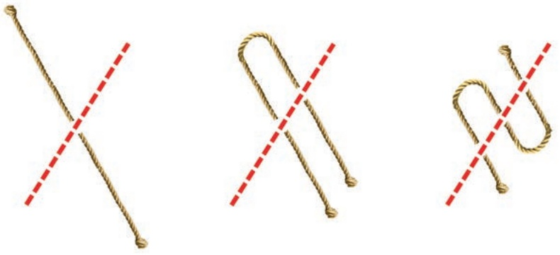
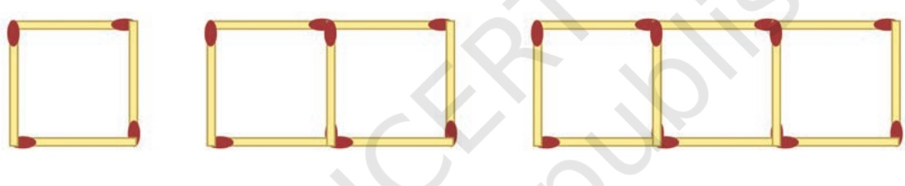
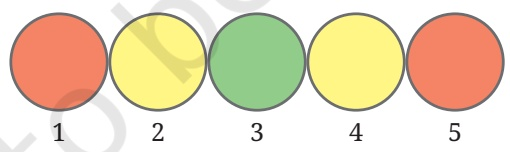

get 3 pieces. Observe the pattern and find the number of pieces if the rope is folded 10 times and cut. What is the expression for the number of pieces when the rope is folded r times and cut?

12. Look at the matchstick pattern below. Observe and identify the pattern. How many matchsticks are required to make 10 such squares. How many are required to make w squares?

13. Have you noticed how the colours change in a traffic signal? The sequence of colour changes is shown below.

Find the colour at positions 90, 190, and 343. Write expressions to describe the positions for each colour.

14. Observe the pattern below. How many squares will be there in Step 4, Step 10, Step 50? Write a general formula. How would the formula change if we want to count the number of vertices of all the squares?