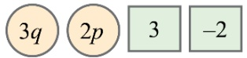

## Ans:

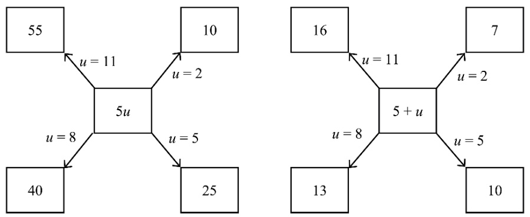

**After filling in the two diagrams, do you think the two expressions are equal?**

**Ans**:

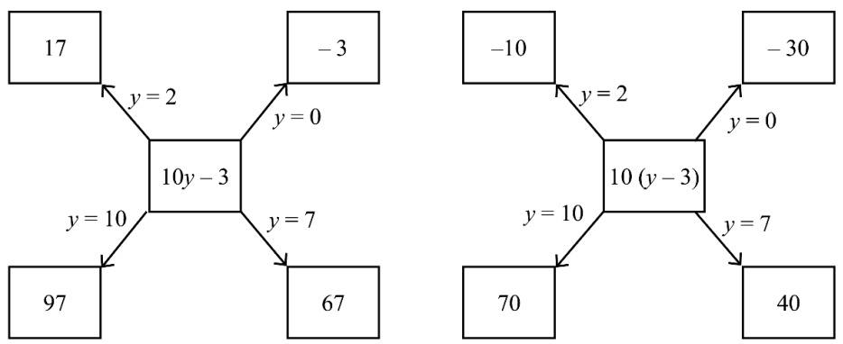

The expressions 10y – 3 and 10(y – 3) are not equal.

**Page No. 93-94**

? **Figure it Out**

？ **Add the numbers in each picture below. Write their corresponding expressions and simplify them. Try adding the numbers in each picture in a couple different ways and see that you get the same thing.**

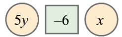

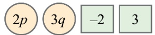

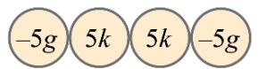

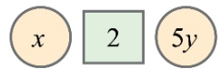

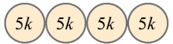

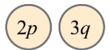

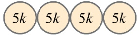

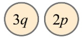

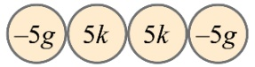

**Ans:**

Some of the ways are