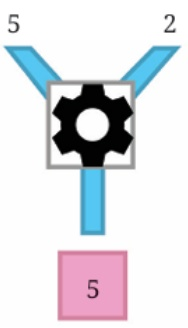
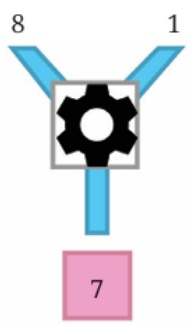
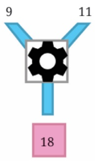
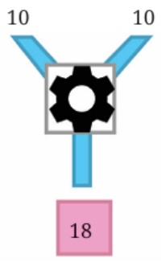
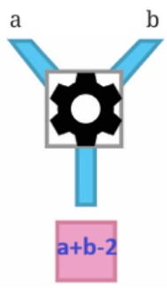
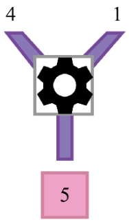
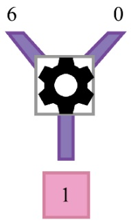
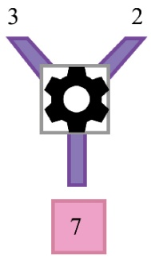
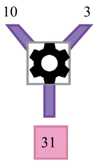
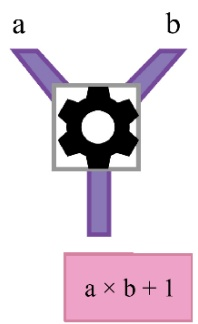

expression:

expression:

expression:

expression:

expression:

**(ii)** Formula: One is added to the multiplication of two numbers.

Algebraic expression= (a × b) + 1 = ab + 1

4th expression: 10 × 3 + 1 = 30 + 1 = 31

5th expression: $a \times b + 1$

expression:

expression:

expression:

expression:

expression:

## Page No. 97

**Use this to find what design appears at positions 99, 122, and 148. Ans:**

1. Design C appears at position 99.

2. Design B appears at position 122.

3. Design A appears at position 148.

## Page No. 99

? **Will this always happen? How do you show this?**

**Ans:** Let’s build a similar 3×3 grid with a Centre number a.

|  | a -7 |  |
| --- | --- | --- |
| a -1 | a | a + 1 |
|  | a + 7 |  |

Here, the sum is

$a-7+a-1+a+a+1+a+7=5a$ (5times the number in the Centre.)