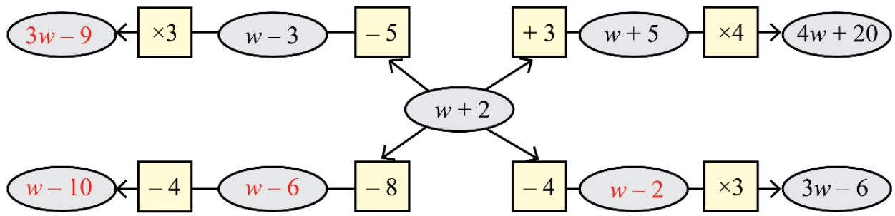

**3. A snail is trying to climb along the wall of a deep well. During the day it climbs up ‘u’ cm and during the night it slowly slips down ‘d’ cm. This happens for 10 days and 10 nights.**

**(a) Write an expression describing how far away the snail is from its starting position.**

**(b) What can we say about the snail’s movement if d > u? Ans:**

(a) 10 (u − d) cm

(b) If d > u, the snail slips down more than it climbs. This means the snail will never reach the top.

**4. Radha is preparing for a cycling race and practices daily. The first week she cycles 5 km every day. Every week she increases the daily distance cycled by ‘z’ km. How many kilometers would Radha have cycled after 3 weeks?**

**Ans:** 105 + 21z km

**5. In the following figure, observe how the expression w + 2 becomes 4w + 20 along one path. Fill in the missing blanks on the remaining paths. The ovals contain expressions and the boxes contain operations.**

**Ans:**

## Page No. 103

**6. A local train from Yahapur to Vahapur stops at three stations at equal distances along the way. The time taken in minutes to travel from one station to the next station is the same and is denoted by t. The train stops for 2 minutes at each of the three stations. (a) If t = 4, what is the**