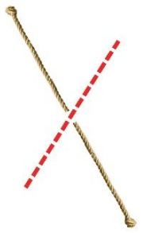
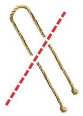

**9. Subtract the expressions given below:**

**(a) 9a – 6b + 14 from 6a + 9b – 18**

**(b) – 15x + 13 – 9y from 7y – 10 + 3x**

**(c) 17g + 9 – 7h from 11 – 10g + 3h**

**(d) 9a – 6b + 14 from 6a – (9b + 18)**

**(e) 10x + 2 + 10y from –3y +8 – 3x**

**(f) 8g + 4h – 10 from 7h – 8g + 20**

## Ans:

(a) – 3a + 15b – 32

(b) 16y + 18x – 23

(c) 10h – 27g + 2

(d) – (3a + 3b + 32)

(e) – 13y – 13x + 6

(f) 3h – 16g + 30

## 10.Describe situations corresponding to the following algebraic expressions:

**Ans:**

**(a) 8x + 3y**

One of the examples is–Situation: A fruit seller sells mangoes at ₹8 each and bananas at ₹3 each. If a customer buys x mangoes and y bananas. The total cost would be 8x + 3y.

## (b) 15x – 2x

Situation: A shopkeeper has 15 pencils in a packet. The cost of one pencil is ₹x. Two pencils in the packet are not sold. Find the amount received for this packet.

**11.Imagine a straight rope. If it is cut once as shown in the picture, we get 2 pieces. If the rope is folded once and then cut as shown, we get 3 pieces. Observe the pattern and find the number of pieces if the rope is folded 10 times and cut. What is the expression for the number of pieces when the rope is folded r times and cut?**

