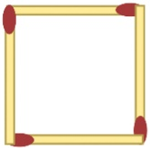
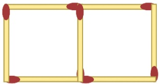
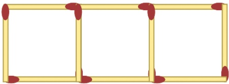
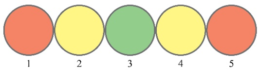

**Ans:** If the rope is folded 10 times and cut, we get 10 + 2 = 12 pieces. In the same way, when the rope is folded r times and cut, we get r + 2 pieces.

## Page No. 104

**12.Look at the matchstick pattern below. Observe and identify the pattern. How many matchsticks are required to make 10 such squares? How many are required to make w squares?**

**Ans:** To make 10 squares, we need

$$
4 + 3 \times 9 = 31   matchrisks
$$

To make w squares the number of matchsticks required is = 4 + 3 (w - 1)

**13.Have you noticed how the colours change in a traffic signal? The sequence of colour changes is shown below. Find the colour at positions 90, 190, and 343. Write expressions to describe the positions for each colour.**

Ans: For Position $\mathbf { 9 0 } ; { \frac { \mathbf { 9 0 } } { 4 } }$

The colour is Yellow.

**For Position 190**: $\frac { \mathbf { 1 9 0 } } { 4 }$

The colour is Yellow

**For Position 343**: $\frac { 3 4 3 } { 4 }$

The colour is Green

**Expressions**:

In general, 4n – 3 positions for red light, 4n – 1 position for green light and 2n position for yellow light.