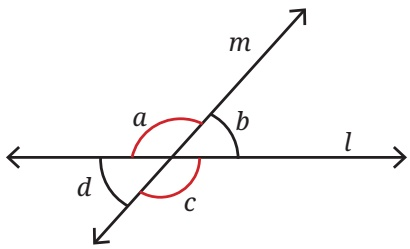

Fig. 5.2

？ Can two straight lines intersect at more than one point?

## Activity 1

Draw two lines on a plain sheet of paper so that they intersect. Measure the four angles formed with a protractor. Draw four such pairs of intersecting lines and measure the angles formed at the points of intersection.

? What patterns do you observe among these angles?

？ In Fig. 5.2, if $\angle a$ is $1 2 0 ^ { \circ }$ , can you figure out the measurements of $\angle b , \angle c$ and $\angle d ,$ without drawing and measuring them?

We know that $\angle a$ and $\angle b$ together measure $1 8 0 ^ { \circ } ,$ because when they are combined, they form a straight angle which measures $1 8 0 ^ { \circ }$ . So, if $\angle a$ is $1 2 0 ^ { \circ }$ , then $\angle b$ must be $6 0 ^ { \circ }$

Similarly, $\angle b$ and $\angle c$ together measure $1 8 0 ^ { \circ }$ . So, if $\angle b$ is $6 0 ^ { \circ }$ , then $\angle c$ must be $1 2 0 ^ { \circ }$ . And $\angle c$ and $\angle d$ together measure $1 8 0 ^ { \circ }$ . So, if $\angle c$ is $1 2 0 ^ { \circ }$ then $\angle d$ must be $6 0 ^ { \circ }$

Therefore, in ${ \mathrm { F i g } } .$ 5.2, $\angle a$ and $\angle c$ measure $1 2 0 ^ { \circ } ]$ , and $\angle b$ and $\angle d$ measure $6 0 ^ { \circ }$

When two lines intersect each other and form four angles, labelled a, b, c and ${ \mathsf { d } } ,$ as in Fig. 5.2, then $\angle a$ and $\angle c$ are equal, and $\angle b$ and $\angle d$ are equal!

## Is this always true for any pair of intersecting lines?

Check this for different measures of $\angle a .$ . Using these measurements, can you reason whether this property holds true for any measure of $\angle a?$

We can generalise our reasoning for Fig. 5.2, without assuming the values ${ \tt o f } \angle \bar { a } .$

Since straight angles measure $1 8 0 ^ { \circ }$ , we must have $\angle a + \angle b = \angle a + \angle d$ $= 1 8 0 ^ { \circ }$ . Hence, $\angle b$ and $\angle d$ are always equal. Similarl $\angle b + \angle a = \angle b +$ $\angle c = 180^{\circ}$ , so $\angle a$ and $\angle c$ must be equal.

Adjacent angles, like $\angle a$ and $\angle b ,$ formed by two lines intersecting each other, are called **linear pairs**. Linear pairs always add up to $1 8 0 ^ { \circ }$