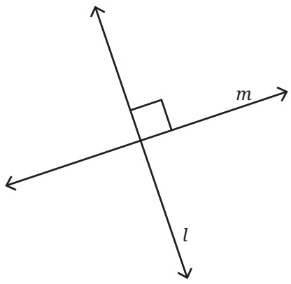
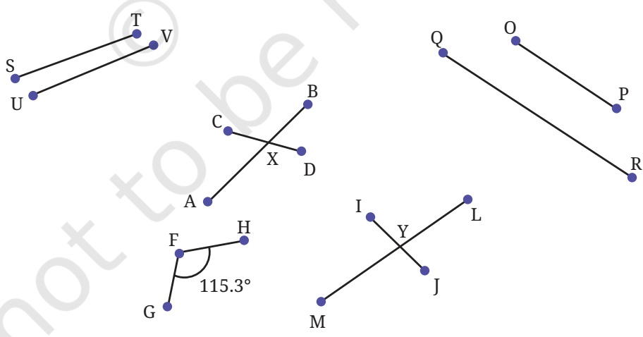

Fig. 5.4

If two lines intersect and all four angles are equal, then each angle must be a right angle (90°).

**Perpendicular lines** are a pair of lines which intersect each other at right angles (90°). In Fig. 5.4, we can say that lines l and m are perpendicular to each other.

## 5.3 Between Lines

Observe Fig. 5.5 and describe the way the line segments meet or cross each other in each case, with appropriate mathematical words (a point, an endpoint, the midpoint, meet, intersect) and the degree measure of each angle.

For example, line segments FG and FH meet at the endpoint F at an angle 115.3°.

Fig. 5.5

Are line segments ST and UV likely to meet if they are extended? Are line segments OP and QR likely to meet if they are extended? Here are some examples of lines we notice around us.