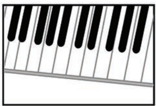
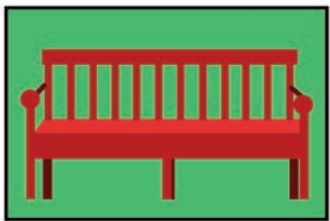
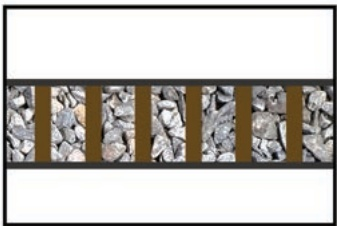
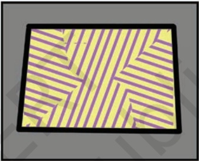
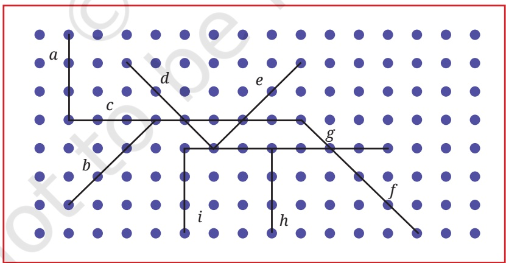

What is common to the lines in the pictures above? They do not seem likely to intersect each other. Such lines are called parallel lines.

**Parallel lines** are a pair of lines that lie on the same plane, and do not meet however far we extend them at both ends.

Name some parallel lines you can spot in your classroom.

Parallel lines are often used in artwork and shading.

？ Which pairs of lines appear to be parallel in Fig. 5.6 below?

Fig. 5.6

**Note to the Teacher:** It is important that the lines lie on the same plane. A line drawn on a table and a line drawn on the board may never meet but that does not make them parallel.