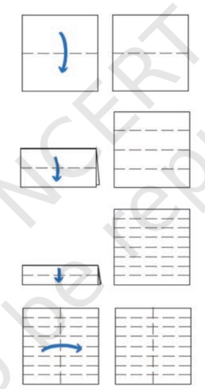

## 5.4 Parallel and Perpendicular Lines in Paper Folding

## Activity 2

Take a plain square sheet of paper (use a newspaper for this activity).

• How would you describe the opposite edges of the sheet? They are to each other.

How would you describe the adjacent edges of the sheet? The adjacent edges are to each other. They meet at a point. They form right angles.

• Fold the sheet horizontally in half. A new line is formed (see Fig. 5.7).

How many parallel lines do you see now? How does the new line segment relate to the vertical sides?

Fig. 5.7

Make one more horizontal fold in the folded sheet. How many parallel lines do you see now?

What will happen if you do it once more? How many parallel lines will you get? Is there a pattern? Check if the pattern extends further, if you make another horizontal fold.

• Make a vertical fold in the square sheet. This new vertical line is to the previous horizontal lines.

• Fold the sheet along a diagonal. Can you find a fold that creates a line parallel to the diagonal line?