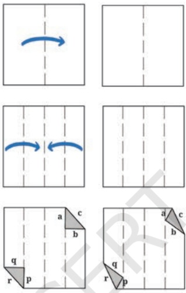
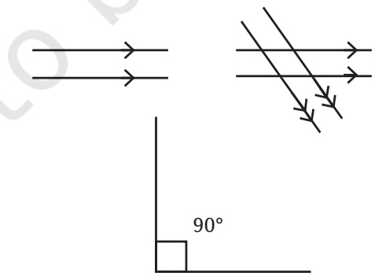

Here is another activity for you to try.

• Take a square sheet of paper, fold it in the middle and unfold it.

• Fold the edges towards the centre line and unfold them.

• Fold the top right and bottom left corners onto the creased line to create triangles. Refer to Fig. 5.8.

• The triangles should not cross the crease lines.

• Are a, b and c parallel to p, q and r respectively? Why or why not?

Fig. 5.8

## Notations

In mathematics, we use an arrow mark (>) to show that a set of lines is parallel. If there is more than one set of parallel lines (as in Fig. 5. 9), the second set is shown with two arrow marks and so on. Perpendicular lines are marked with a square angle between them.

Fig. 5.9