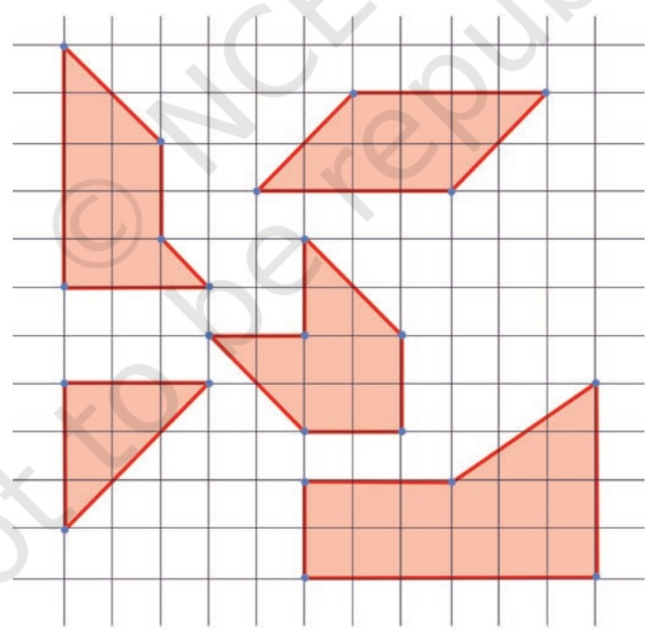

## Figure it Out

1. Draw some lines perpendicular to the lines given on the dot paper in Fig. 5.10.

Fig. 5.10

2. In Fig. 5.11, mark the parallel lines using the notation given above (single arrow, double arrow etc.). Mark the angle between perpendicular lines with a square symbol.

(a) How did you spot the perpendicular lines?

(b) How did you spot the parallel lines?

Fig. 5.11

3. In the dot paper following, draw different sets of parallel lines. The line segments can be of different lengths but should have dots as endpoints.