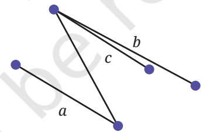

4. Using your sense of how parallel lines look, try to draw lines parallel to the line segments on this dot paper.

$$
\begin{array} { c c c c c c c c c c c c c c } { \bullet } & { \bullet } & { \bullet } & { \bullet } & { \bullet } & { \bullet } & { \bullet } & { \bullet } & { \bullet } & { \bullet } & { \bullet } & { \bullet } & { \bullet } & { \bullet } \\ { \bullet } & { \bullet } & { \bullet } & { \bullet } & { \bullet } & { \bullet } & { \bullet } & { \bullet } & { \bullet } & { \bullet } & { \bullet } & { \bullet } & { \bullet } & { \bullet } \\ { \bullet } & { \bullet } & { \bullet } & { \bullet } & { \bullet } & { \bullet } & { \bullet } & { \bullet } & { \bullet } & { \bullet } & { \bullet } & { \bullet } & { \bullet } & { \bullet } \\ { \bullet } & { \bullet } & { \bullet } & { \bullet } & { \bullet } & { \bullet } & { \bullet } & { \bullet } & { \bullet } & { \bullet } & { \bullet } & { \bullet } & { \bullet } & { \bullet } \\ { \bullet } & { \bullet } & { \bullet } & { \bullet } & { \bullet } & { \bullet } & { \bullet } & { \bullet } & { \bullet } & { \bullet } & { \bullet } & { \bullet } & { \bullet } & { \bullet } & { \bullet } \\ { \bullet } & { \bullet } & { \bullet } & { \bullet } & { \bullet } & { \bullet } & { \bullet } & { \bullet } & { \bullet } & { \bullet } & { \bullet } & { \bullet } & { \bullet } & { \bullet } \\ { \bullet } & { \bullet } & { \bullet } & { \bullet } & { \bullet } & { \bullet } & { \bullet } & { \bullet } & { \bullet } & { \bullet } & { \bullet } & { \bullet } & { \bullet } \\ { \bullet } & { \bullet } & { \bullet } & { \bullet } & { \bullet } & { \bullet } & { \bullet } & { \bullet } & { \bullet } & { \bullet } & { \bullet } & { \bullet } & { \bullet } \\ { \bullet } & { \bullet } & { \bullet } & { \bullet } & { \bullet } & { \bullet } & { \bullet } & { \bullet } & { \bullet } & { \bullet } & { \bullet } & { \bullet } \\ { \bullet } & { \bullet } & { \bullet } & { \bullet } & { \bullet } & { \bullet } & { \bullet } & { \bullet } & { \bullet } & { \bullet } & { \bullet } & { \bullet } \\ { \bullet } & { \bullet } & { \bullet } & { \bullet } & { \bullet } & { \bullet } & { \bullet } & { \bullet } & { \bullet } & { \bullet } & { \bullet } & { \bullet } \\ { \bullet } & { \bullet } & { \bullet } & { \bullet } & { \bullet } & { \bullet } & { \bullet } & { \bullet } & { \bullet } & { \bullet } & { \bullet } & { \bullet } \\ { \bullet } & { \bullet } & { \bullet } & { \bullet } & { \bullet } & { \bullet } & { \bullet } & { \bullet } & { \bullet } & \end{array}
$$

(a) Did you find it challenging to draw some of them?

(b) Which ones?

(c) How did you do it?

5. In Fig. 5.13, which line is parallel to line a line b or line $c 9$ How do you decide this?

Fig. 5.13

**Note to the Teacher:** It is easier to draw vertical and horizontal lines and the ones inclined at $4 5 ^ { \circ }$ (on rectangular dot sheets), but drawing a line parallel to one which has a different orientation is slightly harder. Let students use their intuition for this.

From previous exercises we observed that sometimes it is difficult to be sure whether two lines are parallel. To determine this we use the idea of transversals.