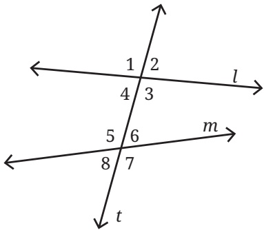

## 5.5 Transversals

We saw what happens when two lines intersect in different ways. Let us explore what happens when one line intersects two different lines.

Fig. 5.14

In Fig. 5.14, line t intersects lines l and m. t is called a **transversal**. Notice that 8 angles are formed when a line crosses a pair of lines.

Is it possible for all the eight angles to have different measurements? Why, why not?

## What about five different angles — 6, 5, 4, 3 and 2?

In Fig. 5.14, since ∠1 and ∠3 are vertically opposite angles, they are equal. Are there other pairs of vertically opposite angles? We can see that there are a total of four pairs of vertically opposite angles and in each pair, the angles are equal to each other.

Thus, when a transversal intersects two lines, it forms eight angles with a maximum of four distinct angle measures.

## 5.6 Corresponding Angles

In Fig. 5.14, we notice that the transversal t forms two sets of angles — one with line l and another with line m. There are angles in the first set that correspond to angles in the second set based on their position. ∠1 and $\angle 5$ are called **corresponding angles**. Similarly, ∠2 and ∠6, ∠3 and ∠7, ∠4 and ∠8 are the corresponding angles formed when transversal t intersects lines l and m.

## Activity 3

Draw a pair of lines and a transversal such that they form two distinct angles.