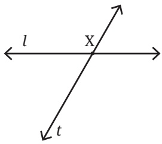
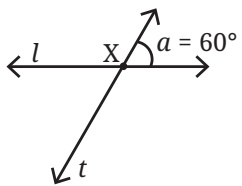
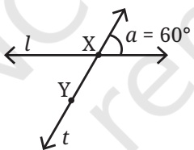
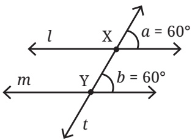

**Step 1:** Draw a line l and a transversal t intersecting it at point X.

Fig. 5.15

**Step 2:** Measure $\angle a$ formed by lines l and t (let us say it is $6 0 ^ { \circ } )$

Fig. 5.16

How many distinct angles have formed now?

If one angle is $6 0 ^ { \circ }$ , the other angle of the linear pair should be $1 2 0 ^ { \circ }$ So, we already have two distinct angles.

So, when we draw another line intersecting the transversal t we wish to form only two angles, $6 0 ^ { \circ }$ and 120°.

**Step 3:** Mark a point Y on line t.

Fig. 5.17

**Step 4:** Draw a line m through point Y that forms a $6 0 ^ { \circ }$ angle to line t. This can be done either by copying $\angle a$ with a tracing paper or you can use a protractor to measure the angles.

Fig. 5.18

What do you observe about lines l and m? Do they appear to be parallel to each other?

Yes, they do appear to be parallel to each other.

Angles, $\angle a$ and $\angle b$ are corresponding angles formed by the transversal t on lines l and m. These corresponding angles are equal to each other.