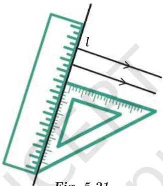
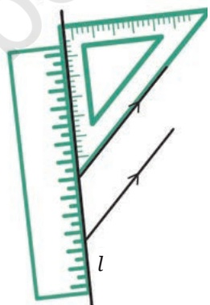

When a pair of lines are not parallel to each other, the corresponding angles formed by a transversal can never be equal to each other.

## 5.7 Drawing Parallel Lines

Can you draw a pair of parallel lines using a ruler and a set square? Fig. 5.21 shows how you can do it.

Draw a line l with a scale. By sliding your set square you can make two lines perpendicular to line l.

Are these two lines parallel to each other? How are we sure that they are parallel to each other? What angles are formed between these lines and line l?

Fig. 5.21

Since we used a set square, the angles measure $9 0 ^ { \circ }$ . The position of the lines is different, but they make the same angle with l. If line l is seen as a transversal to the two new lines, then the corresponding angles measure $9 0 ^ { \circ } .$

Fig. 5.22

As we know these are corresponding angles and they are equal, we can be sure that the lines are parallel.

Draw two more parallel lines using the long side of the set square as shown in Fig. 5.22.