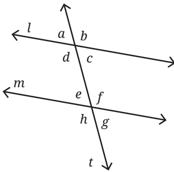

• Why are lines l and m parallel to each other?

## 5.8 Alternate Angles

In Fig. 5.25, $\angle d$ is called the **alternate angle** of $\angle f ,$ and $\angle c$ is the alternate angle of $\angle e$

Fig. 5.25

You can find the alternate angle of a given angle, say $\angle f ,$ by first finding the corresponding angle of $\angle f ,$ which is $\angle b$ and then finding the vertically opposite angle of $\angle b ,$ , which is $\angle d .$

## Activity 6

In Fig. 5.25, if $\angle f$ is $1 2 0 ^ { \circ }$ what is the measure of its alternate angle $\angle d ?$ We can find the measure of $\angle d$ if we know $\angle b$ because they are vertically opposite angles. Remember, vertically opposite angles are equal.

What is the measure of $\mathbb { Z } b ?$ It is $1 2 0 ^ { \circ }$ because it is the corresponding angle of $\angle f .$

So, $\angle d$ also measures $1 2 0 ^ { \circ } ,$

In fact, $\angle f = \angle b$ irrespective of the measure of $\angle f .$ Why? Because $\angle b$ is the corresponding angle of $Z   f .$

Similarly, $\angle b = \angle d$ irrespective of the measure of $\angle b$ . Why? Because $\angle d$ is the vertically opposite angle of ∠b. So, it must always be the $\angle b .$ case that

$$
\angle f = \angle d
$$

Using our understanding of corresponding angles without any measurements, we have justified that alternate angles are always equal.

Alternate angles formed by a transversal intersecting a pair of parallel lines are always equal to each other.

？ **Example 1:** In Fig. 5.26, parallel lines l and m are intersected by the transversal t. If $\angle 6$ is $1 3 5 ^ { \circ }$ , what are the measures of the other angles?