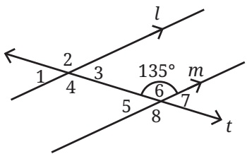
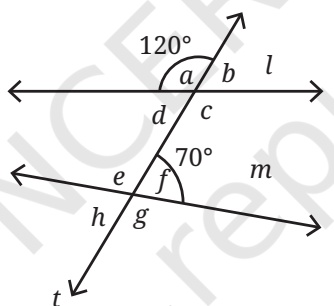
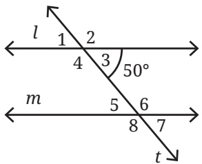

Fig. 5.26

**Solution:** $\angle 6$ is $1 3 5 ^ { \circ }$ , so $\angle 2$ is also $1 3 5 ^ { \circ } ,$ , because it is the corresponding angle of $\angle 6$ and the lines l and m are parallel.

∠8 is $1 3 5 ^ { \circ }$ , because it is the vertically opposite angle of $\angle 6 . \angle 4$ is $1 3 5 ^ { \circ }$ because it is the corresponding angle of $\angle 8 .$

$\angle 2$ is $1 3 5 ^ { \circ }$ because is the vertically opposite angle of $\angle 4.\; \mathsf{S}0, \angle 2, \angle 4,$ $\angle 6 ,$ and $\angle 8$ are all $1 3 5 ^ { \circ }$

∠5 and $\angle 6$ are a linear pair, together they measure $1 8 0 ^ { \circ }$ . If $\angle 6$ is $1 3 5 ^ { \circ }$ , then

$$
\angle 5 = 180 - 135 = 45^{\circ}
$$

We can similarly find out that $\angle 1 , \angle 3 ,$ , and $\angle 7$ measure $4 5 ^ { \circ }$

？ **Example 2:** In Fig. 5.27, lines l and m are intersected by the transversal t. If $\angle a$ is $1 2 0 ^ { \circ }$ and $\angle f$ is $7 0 ^ { \circ }$ , are lines l and m parallel to each other?

Fig. 5.27

**Solution:** $\angle a$ is $1 2 0 ^ { \circ }$ , so $\angle b$ is $6 0 ^ { \circ }$ because $\angle a$ and $\angle b$ form a linear pair. $\angle b$ is a corresponding angle of $\angle f .$ If l and m are parallel, $\angle b$ should be equal to $\angle f ,$ however, they are not equal.

Therefore, lines l and m are not parallel to each other as the corresponding angles formed by the transversal t are not equal to each other.

**Example 3:** In Fig. 5.28, parallel lines l and m are intersected by the transversal t. If $\angle 3$ is $5 0 ^ { \circ }$ , what is the measure of $\angle 6 7$

Fig. 5.28