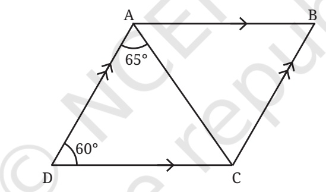

**Solution:** $\angle 3$ is $5 0 ^ { \circ } ;$ therefore, $\angle 2$ is $1 3 0 ^ { \circ } ,$ , because $\angle 2$ and $\angle 3$ form a linear pair, and linear pairs always add up to $1 8 0 ^ { \circ }$

∠2 and $\angle 6$ are corresponding angles, and they need to be equal since lines l and m are parallel.

So, $\angle 6$ is $1 3 0 ^ { \circ }$

Angles $\angle 3$ and $\angle 6$ are called **interior angles**.

Is there a relation between $\angle 3$ and $\angle 6 7$ You could try to find the relationship by taking different values for $\angle 3$ and see what $\angle 6$ is. Once you find a relation, try to justify it or prove that this relation holds always. You will find that the sum of the interior angles on the same side of the transversal always add up to $1 8 0 ^ { \circ }$

? **Example 4:** In Fig. 5.29, line segment AB is parallel to CD and AD is parallel to BC. ∠DAC is $6 5 ^ { \circ }$ and $\angle  ADC$ is $6 0 ^ { \circ }$ . What are the measures of angles $\angle CAB , \angle ABC,$ and ∠BCD?

Solution: Let us observe the parallel lines AB and CD. AD is a transversal of these two lines.

Fig. 5.29

We know that the sum of the interior angles formed by a transversal on a pair of parallel lines adds up to $1 8 0 ^ { \circ }$ . So

$$
\angle ADC+\angle DAB=180^{\circ}
$$

$$
60^{\circ} + \angle  DAB  = 180^{\circ}.
$$

$$
\mathrm{SO} \angle \mathrm{DAB} = 120^{\circ}.
$$

Can we find $\angle \mathrm { C A B }$ from this?

$$
\angle DAB = \angle DAC + \angle CAB.
$$

So $120^{\circ} = 65^{\circ} + \angle  CAB$

So $\angle CAB = 55^{\circ}$

Let us observe the parallel line segments AD and BC. They are intersected by a transversal CD. $\mathrm{So}, \angle \mathrm{ADC}+\angle \mathrm{BCD}=180^{\circ}$ , because they are interior angles on the same side of the transversal. Since $\angle  ADC$ is given as $6 0 ^ { \circ } , \angle \mathrm { B C D } = 1 2 0 ^ { \circ }$

Similarly, we find $\angle ABC = 60^{\circ}$

Therefore, in Fig. $5.29,\angle CAB = 55^{\circ},\angle ABC = 60^{\circ}$ , and $\angle BCD = 120^{\circ}$