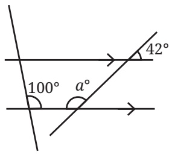
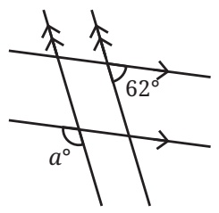
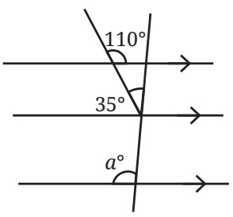
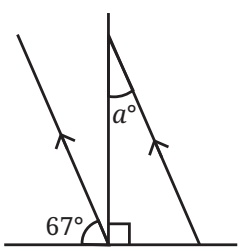
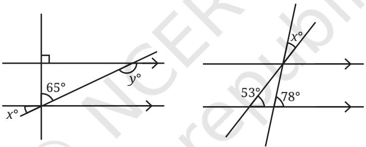
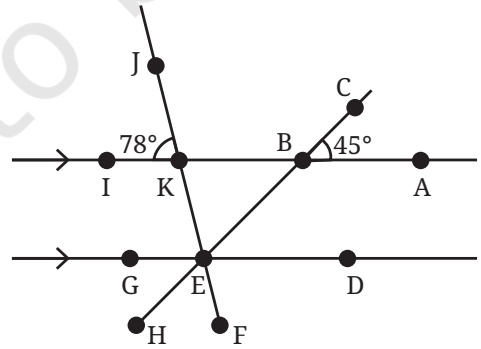

2. Find the angle represented by a.

Fig. 5.31

3. In the figures below, what angles do x and y stand for?

Fig. 5.32

4. In Fig. 5.33, $\angle ABC = 45^{\circ}$ and $\angle \mathrm{IKJ} = 78^{\circ}$ . Find angles $\angle \mathrm { G E H } ,$ $\angle  HEF ,$ ∠FED

Fig. 5.33