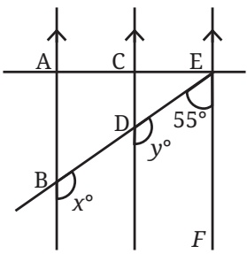
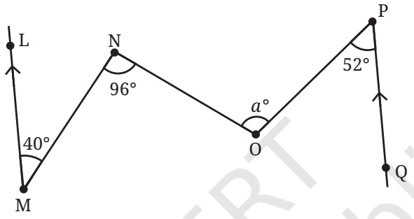
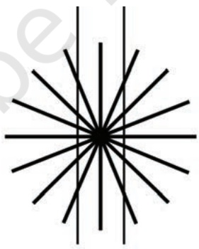
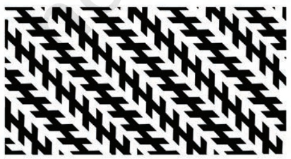
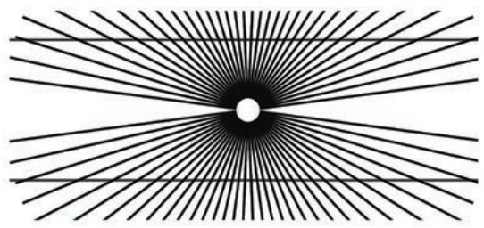

5. In Fig. 5.34, AB is parallel to CD and CD is parallel to EF. Also, EA is perpendicular to AB. If $\angle  BEF = 55^{\circ}$ , find the values of x and y.

Fig. 5.34

6. What is the measure of angle $\angle  NOP$ in Fig. 5.35?

Fig. 5.35

[**Hint:** Draw lines parallel to LM and PQ through points N and O.]

## 5.9 Parallel Illusions

There do not seem to be any parallel lines here. Or, are there?

What causes these illusions?

