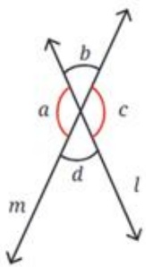

**Page No. 107**

？ **Can two straight lines intersect at more than one point? Ans:** No

**What patterns do you observe among these angles? Ans:**

∠a = ∠c and ∠b = ∠d.

∠a + ∠b = 180° and ∠b + ∠c = 180°.

Find more such relations.

**Is this always true for any pair of intersecting lines? Ans:** Yes

**Page No. 108.**

？ **Figure it Out**

**List all the linear pairs and vertically opposite angles you observe in Fig. 5.3:**

| Linear Pairs | ∠a and $\angle b ,$ … |
| --- | --- |
| Pairs of Vertically Opposite Angles | ∠b and $\angle d , \ldots$ |

Fig. 5.3

**Ans:**

| Linear Pairs | ∠a and ∠b, ∠b and ∠c, ∠c and ∠d, ∠d and ∠a. |
| --- | --- |
| Pairs of Vertically Opposite Angles | ∠b and ∠d, ∠a and ∠c |