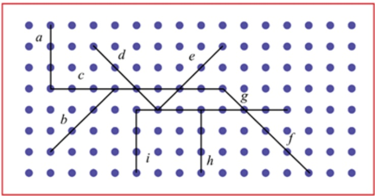

？ **Which pairs of lines appear to be parallel in Fig. 5.6 below?**

Fig. 5.6

**Ans:** a, i and $h ;$ c and g; d and f; e and b

## Page No. 111

## Activity 2

**Take a plain square sheet of paper (use a newspaper for this activity).**

**How would you describe the opposite edges of the sheet? They** are to each other.

**How would you describe the adjacent edges of the sheet? The** adjacent edges are to each other. They meet at a point. **They form right angles.**

**Fold the sheet horizontally in half. A new line is formed (see Fig. 5.7).**

**How many parallel lines do you see now? How does the new line segment relate to the vertical sides?**