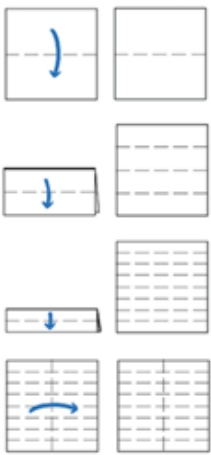

Fig. 5.7

**Make one more horizontal fold in the folded sheet. How many parallel lines do you see now?**

**What will happen if you do it once more? How many parallel lines will you get? Is there a pattern? Check if the pattern extends further, if you make another horizontal fold.**

**Make a vertical fold in the square sheet. This new vertical line** is to the previous horizontal lines.

**Fold the sheet along a diagonal. Can you find a fold that creates a line parallel to the diagonal line?**

## Ans:

## Fill in the Blanks

● The opposite edges of the sheet are **parallel** to each other.

● The adjacent edges of the sheet are **perpendicular** to each other.

## First Horizontal Fold

● We will see **three** parallel lines. The new line segment is **perpendicular** to the vertical sides.

## Subsequent Horizontal Folds

After one more horizontal fold, we will see a total of **five** parallel lines. The two original horizontal edges, the first fold line, and the second fold line are all parallel to each other.

● If we fold it horizontally one more time, we will get **nine** parallel lines. Yes, the pattern is $2 ^ { \mathrm { n } } + 1$ , where n is the number of folds.