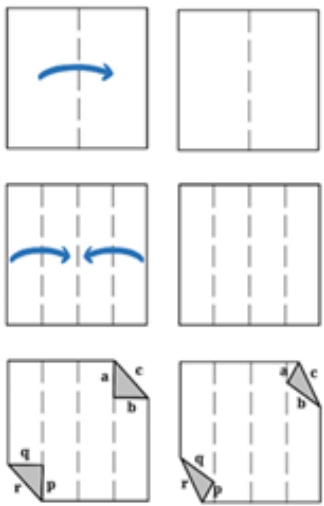

## Vertical and Diagonal Folds

• This new vertical line is **perpendicular** to the previous horizontal lines.

• Yes, we can find a fold that creates a line parallel to the diagonal line.

## Page No. 112

**Here is another activity for you to try.**

**Take a square sheet of paper, fold it in the middle and unfold it.**

• **Fold the edges towards the centre line and unfold them.**

**Fold the top right and bottom left corners onto the creased line to create triangles. Refer to Fig. 5.8.**

**The triangles should not cross the crease lines.**

• **Are a, b and c parallel to p, q and r respectively? Why or why not?**

Fig. 5.8

## Ans:

• Line segments a, b and c are parallel to Line segments p, q and r respectively.

a and p lie on parallel lines. b, q are both respectively perpendicular to these, so are parallel to each other.

c, r are both parallel because the triangular folds create lines parallel to the same diagonal.