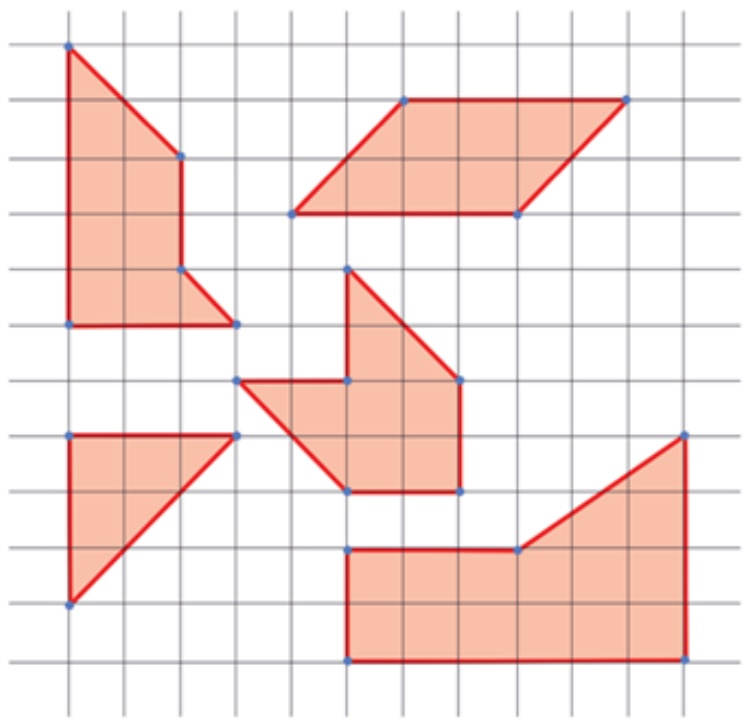
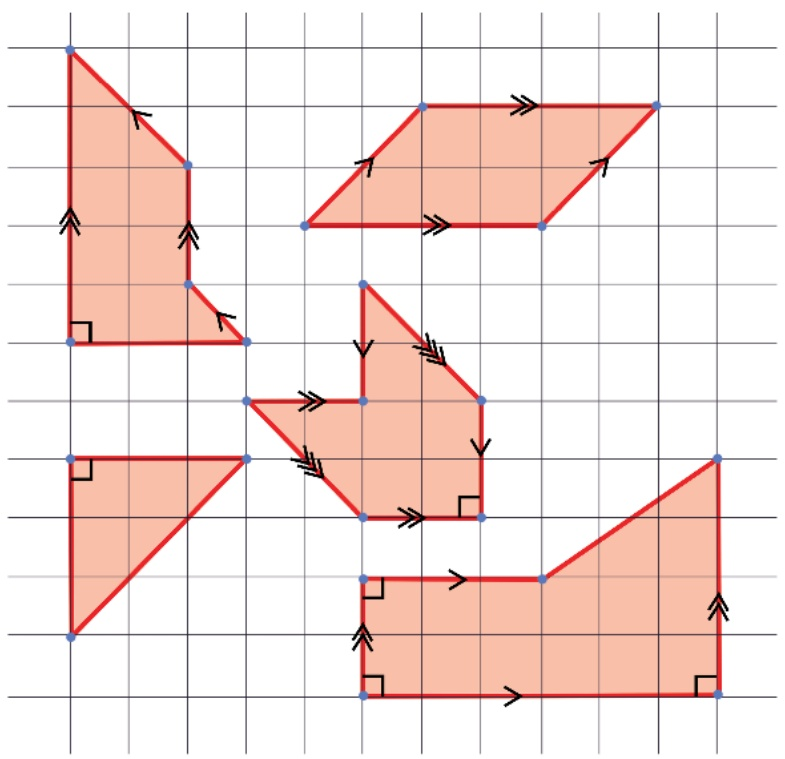

**2. In the given Fig.5.11, mark the parallel lines using the notation given above (single arrow, double arrow, etc). Mark the angle between perpendicular lines with a square symbol. (a)How did you spot the perpendicular lines? (b)How did you spot the parallel lines?**

Fig. 5.11

