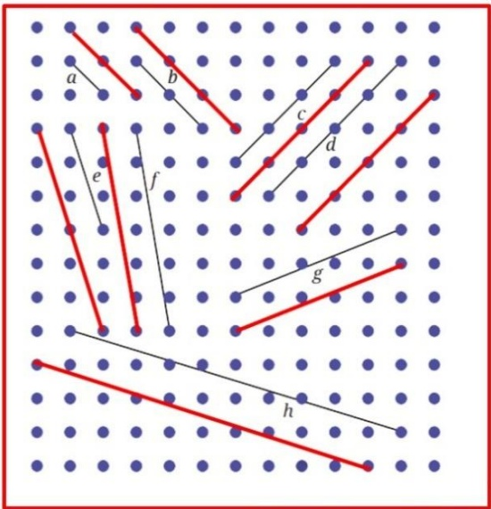
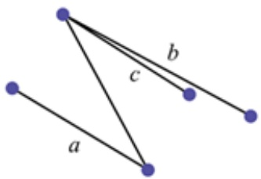

**(a) Did you find it challenging to draw some of them?**

**(b) Which ones?**

**(c) How did you do it?**

**Ans:** Some of the lines are

(a) Yes

(b) Line segments e, f, h, and $g .$

(c) Parallel lines are drawn by keeping them equidistant from the given line.

**5. In Fig 5.13, which line is parallel to line a — line b or line c? How do you decide this?**

Fig. 5.13

**Ans:** In the given figure, line c is parallel to line a because these two lines are always at the same distance apart.