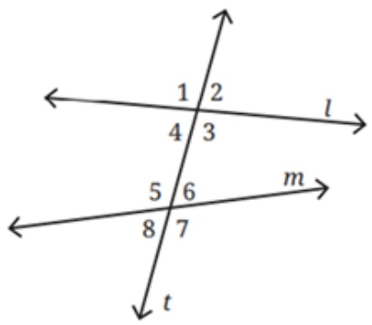
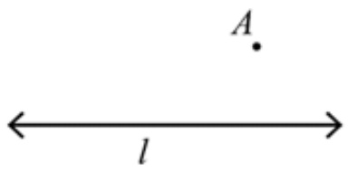

Page No. 115

？ **Is it possible for all the eight angles to have different measurements? Why, why not?**

**Ans:** No, because $\angle 1 = \angle 3 , \angle 2 = \angle 4 , \angle 5 = \angle 7 ,$ and $\angle 6 = \angle 8$ (vertically opposite angles are equal).

**What about five different angles — 6, 5, 4, 3 and 2?**

**Ans:** No, because $\angle 2 = \angle 4.$

**Page No. 119**

？ **Figure it Out**

**Can you draw a line parallel to l, that goes through point A? How will you do it with the tools from your geometry box? Describe your method.**

## Ans:

Tools required: Ruler, Set-squares (right-angled triangle), Pencil, eraser **Steps:**

1. Place the set square so that one side is along the line l.

2. Hold the ruler against the other side of the set square so that the ruler won’t move.

3. Slide the set square along the ruler until one side reaches point A.

4. Draw a line along the edge of the set square through point A.