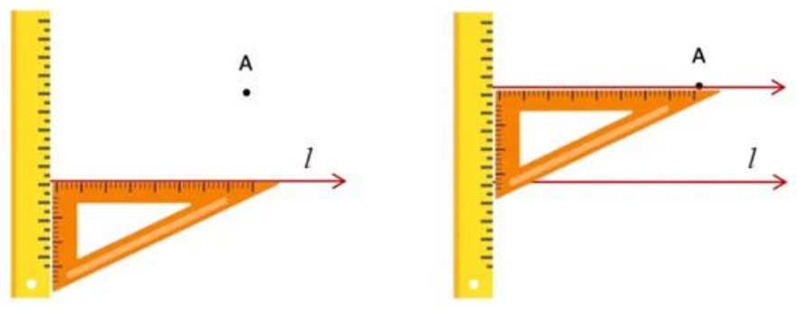
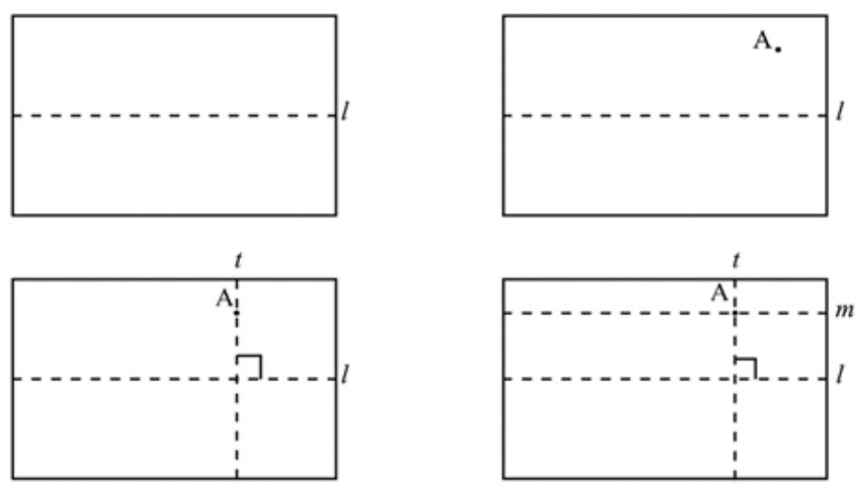

5. This new line is parallel to line l and passes through point A.

Page No. 120.

？ **Why are lines l and m parallel to each other?**

## Ans:

When we fold the paper, first we make line t perpendicular to l passing through A. Then we make another line m perpendicular to t through point A. Since lines l and m are perpendicular to t, so pair of corresponding angles are equal i.e. 900. Thus, l and m are parallel.