**Page No. 123-125**

? **Figure it Out**

**1. Find the angles marked below.**

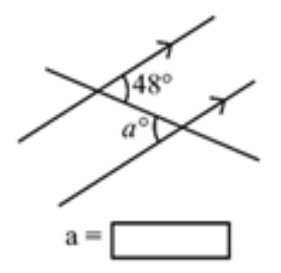

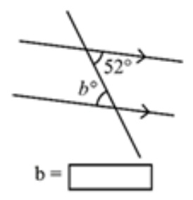

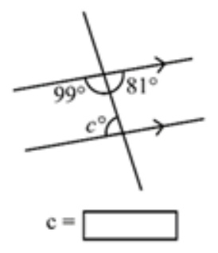

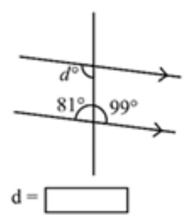

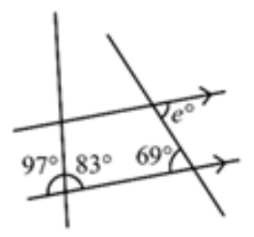

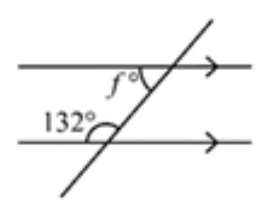

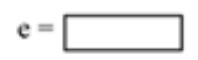

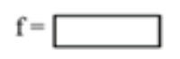

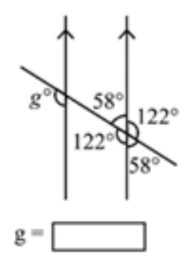

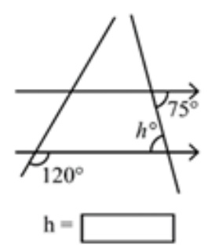

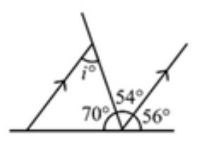

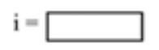

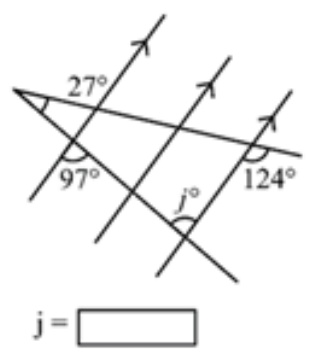

**Ans:**

$$
\angle \mathrm{a} = 48^{\circ}
$$

$$
\angle \mathrm{b} = 52^{\circ}
$$

$$
\angle \mathtt { C } = 8 1 ^ { \circ }
$$

$$
\angle \mathrm{d} = 99^{\circ}
$$

$$
\angle \mathrm{e} = 69^{\circ}
$$

$$
\angle \mathrm{f} = 48^{\circ}
$$

$$
\angle \mathrm{g} = 122^{\circ}
$$

$$
\angle \mathrm{h} = 75^{\circ}
$$

$$
\angle \dot { \mathrm { { \scriptsize ~ i } } } = 5 4 ^ { \circ }
$$

$$
\angle \mathrm { j } = 9 7 ^ { \circ }
$$