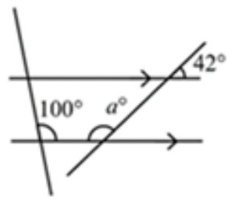
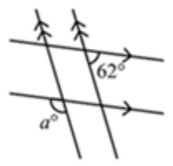
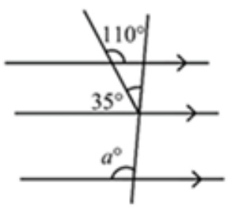
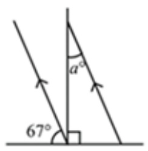
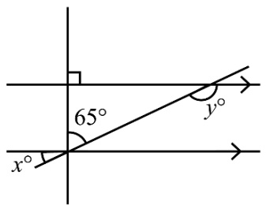
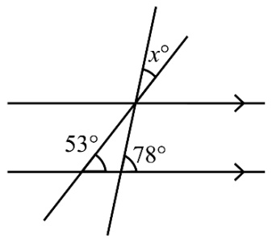
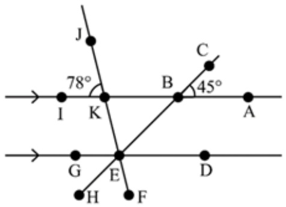

2. Find the angle represented by a.

(i)

(ii)

(iii)

Ans: (i) 138°

(ii) $1 1 8 ^ { \circ }$

(iii) $1 0 5 ^ { \circ }$

(iv) $2 3 ^ { \circ }$

3. In the figures below, what angles do x and y stand for?

Ans:

(i) $\angle x = 2 5 ^ { \circ } ,$ $\angle y = 155^{\circ}$ (ii) $\angle x = 25^{\circ}$

4. In Figure, $\angle ABC = 45^{\circ}$ and $\angle \mathbf{I}\mathbf{K}\mathbf{J} = 78^{\circ}$ . Find angles ∠GEH, ∠HEF, ∠FED.

Ans:

$$
\angle GEH = 45^{\circ}
$$

$$
\angle  HEF = 57^{\circ};
$$

$$
\angle  FED = 78^{\circ}
$$