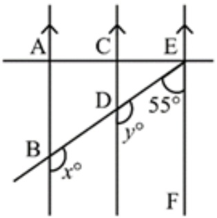
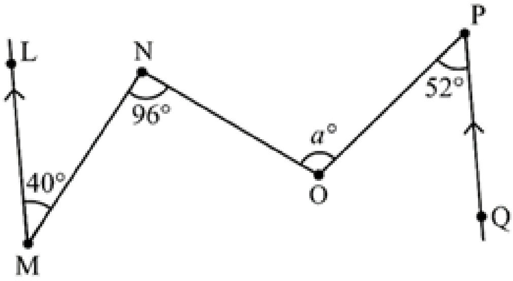

**5. In the Figure, AB is parallel to CD, and CD is parallel to EF. Also, EA is perpendicular to AB.** $\mathbf{I}\mathbf{f} \angle \mathbf{B}\mathbf{E}\mathbf{F} = 55^{\circ}$ **, find the values of x and y.**

**Ans:** $\angle x = \angle y = 125^{\circ}$ [Corresponding Angles]

**6. What is the measure of angle** $\angle \mathbf { N O P }$ **in the given figure?**

**[Hint: Draw lines parallel to LM and PQ through points N and O]**

**Ans:** $\angle NOP = 108^{\circ}$