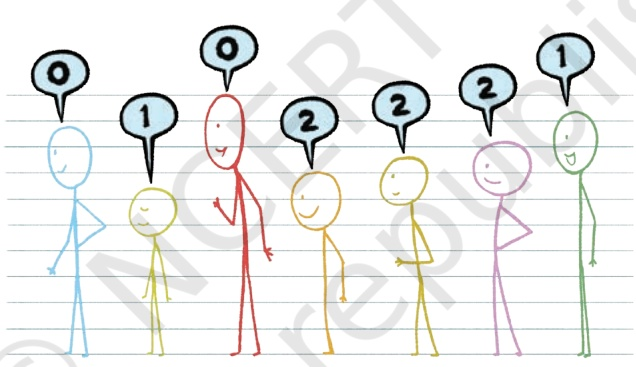
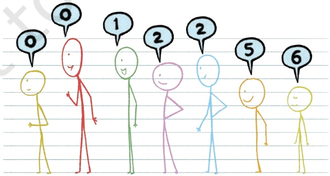

0774CH06

## 6.1 Numbers Tell us Things

What do the numbers in the figure below tell us?

Remember the children from the Grade 6 textbook of mathematics? Now, they call out numbers using a different rule.

What do you think these numbers mean?

The children rearrange themselves and each one says a number based on the new arrangement.

？ Could you figure out what these numbers convey? Observe and try to find out.