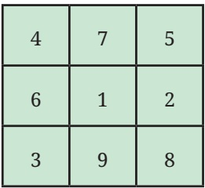
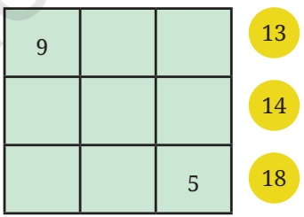
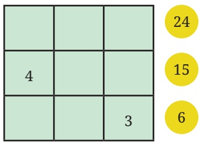

## What is the 100th even number?

This is 2 × 100 = 200.

Does this help in finding the 100th odd number? Let us compare the sequence of evens and odds term-by-term.

**Even Numbers:** 2, 4, 6, 8, 10, 12,...

**Odd Numbers:** 1, 3, 5, 7, 9, 11,...

We see that at any position, the value at the odd number sequence is one less than that in the even number sequence. Thus, the 100th odd number is 200 – 1 = 199.

## Write a formula to find the $n ^ { \mathrm { t h } }$ odd number.

Let us first describe the method that we have learnt to find the odd number at a given position:

(a) Find the even number at that position. This is 2 times the position number.

(b) Then subtract 1 from the even number.

Writing this in expressions, we get

(a) 2n

(b) $2 n - 1$

Thus, 2n is the formula that gives the $n ^ { \mathrm { t h } }$ even number, and 2n – 1 is the formula that gives the $n ^ { \mathrm { t h } }$ odd number.

## 6.3 Some Explorations in Grids

Observe this 3 × 3 grid. It is filled following a simple rule — use numbers from 1 – 9 without repeating any of them. There are circled numbers outside the grid.

## Are you able to see what the circled numbers represent?

17

15

The numbers in the yellow circles are the sums of the corresponding rows and columns.

Fill the grids below based on the rule mentioned above:

13

14

18

24

9

12

24

15

6

12

16

17