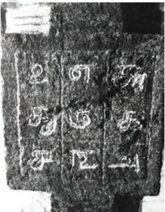
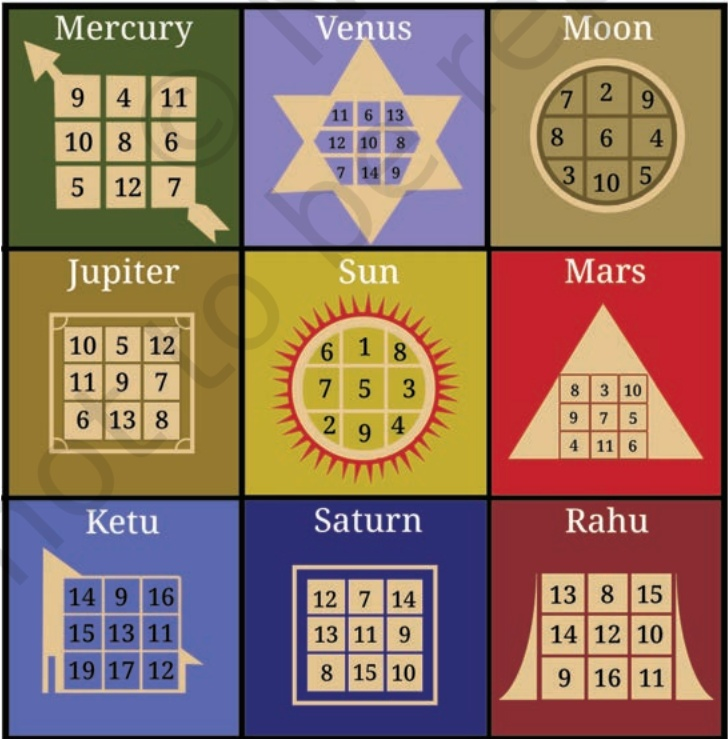

## Magic Squares in History and Culture

The first magic square ever recorded, the Lo Shu Square, dates back over 2000 years to ancient China. The legend tells of a catastrophic flood on the Lo River, during which the gods sent a turtle to save the people. The turtle carried a $3 \times 3$ grid on its back, with the numbers 1 to 9 arranged in a magical pattern.

| 2 | 7 | 6 |
| --- | --- | --- |
| 9 | 5 | 1 |
| 4 | 3 | 8 |

Magic squares were studied in different parts of

the world at different points of time including India, Japan, Central Asia, and Europe.

Indian mathematicians have worked extensively on magic squares, describing general methods of constructing them.

The work of Indian mathematicians was not just limited to 3 × 3 and 4 × 4 grids, which we considered above, but also extended to 5 × 5 and other larger square grids. We shall learn more about these in later grades.

The occurrence of magic squares is not limited to scholarly mathematical works. They are found in many places in India. The picture to the right is of a 3 × 3 magic square found on a pillar in a temple in Palani, Tamil Nadu. The temple dates back to the 8th century CE.

3 × 3 magic squares can also be found in homes and shops in India. The Navagraha Yantra is one such example shown below.

