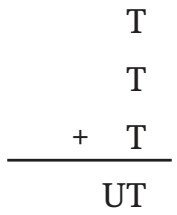
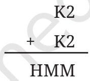

In the calculations below, digits are replaced by letters. Each letter stands for a particular digit (0 – 9). You have to figure out which digit each letter stands for.

Here, we have a one-digit number that, when added to itself twice, gives a 2-digit sum. The units digit of the sum is the same as the single digit being added.

## What could U and T be? Can T be 2? Can it be 3?

Once you explore, you will see that T = 5 and UT = 15.

Let us look at one more example shown on the right. HMM Here K2 means that the number is a 2-digit number having the digit ‘2’ in the units place and ‘K’ in the tens place. K2 is added to itself to give a 3-digit sum HMM. What digit should the letter M correspond to?

Both the tens place and the units place of the sum have the same digit.

## What about H? Can it be 2? Can it be 3?

These types of questions can be interesting and fun to solve! Here are some more questions like this for you to try out. Find out what each letter stands for.

Share how you thought about each question with your classmates; you may find some new approaches.

| YY Z 十 | B5 KP |  | C1 |
| --- | --- | --- | --- |
| 3D + ZOO ED5 | KP + PRR | + | C 1FF |

These types of questions are called ‘cryptarithms’ or ‘alphametics’.

## Figure it Out

1. A light bulb is ON. Dorjee toggles its switch 77 times. Will the bulb be on or off? Why?