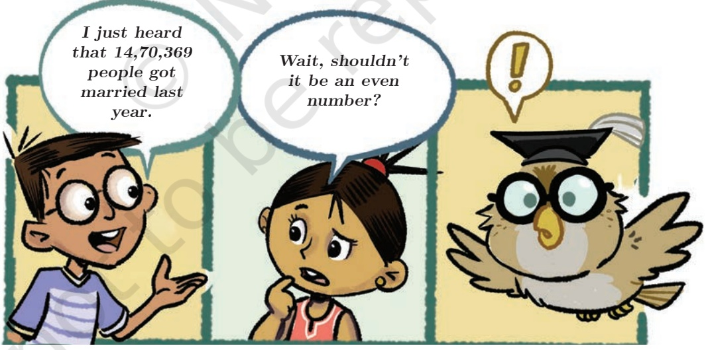

# SUMMARY

In this chapter, we have explored the following:

In the first activity, we saw how to represent information about how a sequence of numbers (e.g., height measures) is arranged without knowing the actual numbers.

We learnt the notion of parity — numbers that can be arranged in pairs (even numbers) and numbers that cannot be arranged in pairs (odd numbers).

• We learnt how to determine the parity of sums and products.

While exploring sums in grids, we could determine whether filling a grid is impossible by looking at the row and column sums. We extended this to construct magic squares.

We saw how Virahāṅka numbers were first discovered in history through the Arts. The Virahāṅka sequence is 1, 2, 3, 5, 8, 13, 21, 34, 55, ...

We became math-detectives through cryptarithms, where digits are replaced by letters.

