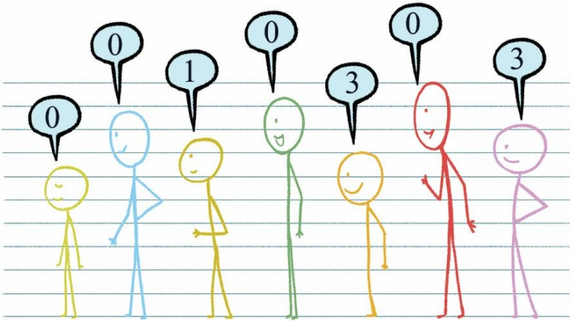

# CHAPTER – 6 Number Play

## Page No- 128

？ **Write down the number each child should say based on this rule for the arrangement shown below.**

## The rule is:

Each child calls out the number of children standing in front of them who are taller than they are. Let’s assign the numbers from left to right for the 7 children:

Child 1: From left → 0

Child 2: From left → 0

Child 3: From left → 1

Child 4: From left → 0

Child 5: From left → 3

Child 6: From left → 0

Child 7: From left → 3

## ? Figure it out

**1. Arrange the stick figure cutouts given at the end of the book or draw a height arrangement such that the sequence reads:**

**(a) 0, 1, 1, 2, 4, 1, 5 (b) 0, 0, 0, 0, 0, 0, 0 (c) 0, 1, 2, 3, 4, 5, 6 (d) 0, 1, 0, 1, 0, 1, 0 (e) 0, 1, 1, 1, 1, 1, 1 (f) 0, 0, 0, 3, 3, 3, 3**