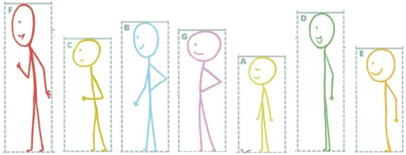

## Ans:

(a) From the cutouts at the back of the book we have → F, C, B, G, A, D, E May also like to draw this way —

Try for other subparts

**2. For each of the statements given below, think and identify if it is Always True, Only Sometimes True, or Never True. Share your reasoning.**

**(a) If a person says ‘0’, then they are the tallest in the group.**

**(b) If a person is the tallest, then their number is ‘0’.**

**(c) The first person’s number is ‘0’.**

**(d) If a person is not first or last in line (i.e., if they are standing somewhere in between), then they cannot say ‘0’.**

**(e) The person who calls out the largest number is the shortest.**

**(f) What is the largest number possible in a group of 8 people?**

## Ans:

(a) Only sometimes true

(b) Always true

(c) Always true

(d) Only sometimes true

(e) Only sometimes true

(f) The largest possible number in a group of 8 people is 7

## Page No- 131

## ？ Figure it out

**1. Using your understanding of the pictorial representation of odd and even numbers, find out the parity of the following sums:**

**(a) Sum of 2 even numbers and 2 odd numbers (e.g., even + even + odd + odd)**

**(b) Sum of 2 odd numbers and 3 even numbers**