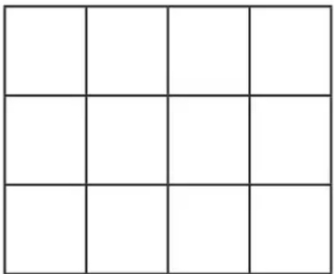

？ **Given the dimensions of a grid, can you tell the parity of the number of small squares without calculating the product?**

## Ans:

The parity of the number of small squares in a grid (with m rows and n columns) is:

(i) Even, if at least one of the numbers (either m or n) is even.

(ii) Odd, if both numbers (m and n) are odd.

(iii) Even, if both numbers (m and n) are even.

## Page No- 132

**Find the parity of the number of small squares in these grids:**

(a) $2 7 \times 1 3$

(b) $4 2 \times 7 8$

(c) 135 × 654

**Ans:**

(a) Odd

(b) Even

(c) Even

？ **Come up with an expression that always has odd parity.**

## Ans:

Some such expressions are 2m + 1, 8a + 3; 4n + 3, 6n + 5 etc.

**Come up with other expressions, like 3n + 4, which could have either odd or even parity.**

## Ans: