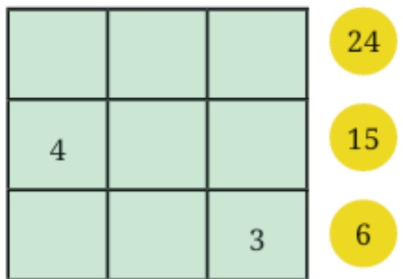

(i) If n is odd, then 3n + 4 is odd then some expressions of odd parity would be— 5n + 2, 9n + 4 etc. Some expressions of even parity — 2n + 4, 4n + 6 etc.

(ii) If n is even, then 3n + 4 is even then all expression will be even parity — (5n – 2), n + 4 etc.

Are there expressions using which we can list all odd numbers? **Ans:** 2n-1 is the expression that can list all odd numbers.

？ **What would be the nth term for multiples of 2? Or, what is the nth even number?**

**Ans:** 2n

？ **Fill the grids below based on the rule mentioned above:**

| 9 |  |  |
| --- | --- | --- |
|  |  |  |
|  |  | 5 |

24

9

13

14

18

24

12

16

15

12

6

17

## Ans:

| 9 | 1 | 3 |
| --- | --- | --- |
| 8 | 2 | 4 |
| 7 | 6 | 5 |

9

13

24

14

18

| 7 | 8 | 9 |
| --- | --- | --- |
| 4 | 6 | 5 |
| 1 | 2 | 3 |

24

15

6

12

16

12

17

Try to find out other possible ways.