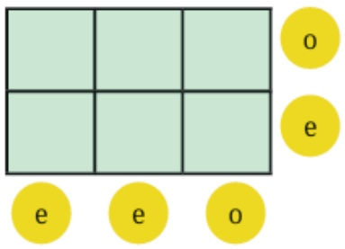
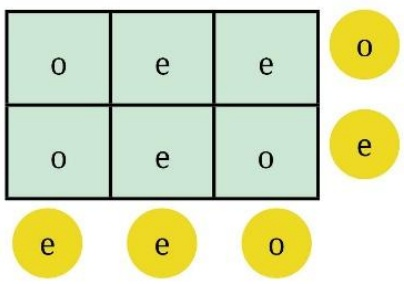

**3. Here is a 2 × 3 grid. For each row and column, the parity of the sum is written in the circle; ‘e’ for even and ‘o’ for odd. Fill the 6 boxes with 3 odd numbers (‘o’) and 3 even numbers (‘e’) to satisfy the parity of the row and column sums.**

**Ans:** One of the ways is –

Try more combinations.

**4. Make a 3 × 3 magic square with 0 as the magic sum. All numbers cannot be zero. Use negative numbers, as needed.**

**Ans:** One of the such magic squares is –

| 3 | -4 | 1 |
| --- | --- | --- |
| -2 | 0 | 2 |
| -1 | 4 | -3 |

**5. Fill in the following blanks with ‘odd’ or ‘even’:**

(a) Sum of an odd number of even numbers is

(b) Sum of an even number of odd numbers is

(c) Sum of an even number of even numbers is

(d) Sum of an odd number of odd numbers is **Ans:**

(a) Even.

(b) Even.