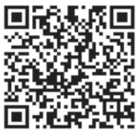
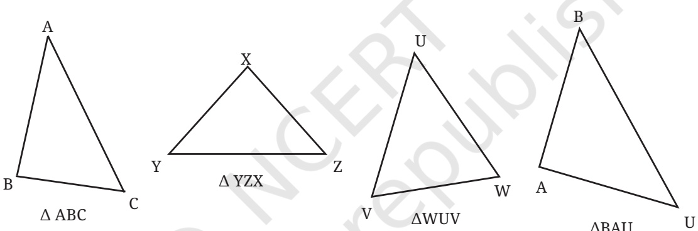

# A TALE OF THREE INTERSECTING LINES

0774CH07

A triangle is the most basic closed shape. As we know, it consists of:

• three corner points, that we call the vertex of the triangle, and

three line segments or the sides of the triangle that join the pairs of vertices.

Triangles come in various shapes. Some of them are shown below.

Observe the symbol used to denote a triangle and how the triangles are named using their vertices. While naming a triangle, the vertices can come in any order.

The three sides meeting at the corners give rise to three angles that we call the angles of the triangle. For example, in ∆ABC, these angles are $\angle CAB , \angle ABC , \angle BCA$ which we simply denote as $\angle \mathrm { A } ,   \angle \mathrm { B }$ and $\angle \complement ,$ respectively.

What happens when the three vertices lie on a straight line?

## 7.1 Equilateral Triangles

Among all the triangles, the equilateral triangles are the most symmetric ones. These are triangles in which all the sides are of equal lengths. Let us try constructing them.

? Construct a triangle in which all the sides are of length 4 cm.