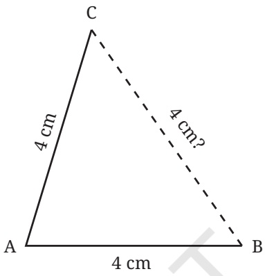
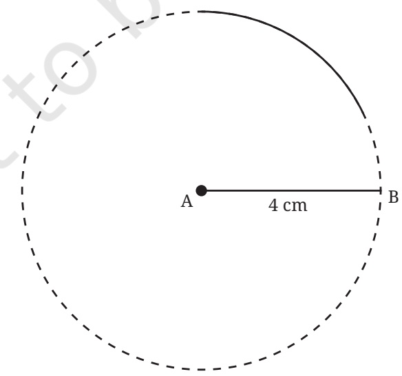

How did you construct this triangle and what tools did you use? Can this construction be done only using a marked ruler (and a pencil)?

Constructing this triangle using just a ruler is certainly possible. But this might require several trials. Say we draw the base — let us call it AB — of length 4 cm (see the figure below), and mark the third point C using a ruler such that AC = 4 cm. This may not lead to BC also having a length of 4 cm. If this happens, we will have to keep making attempts to mark C till we get BC to be 4 cm long.

How do we make this construction more efficient?

Recall solving a similar problem in the previous year using a compass (in the Chapter ‘Playing with Constructions’). We had to mark the top point of a ‘house’ which is 5 cm from two other points. The method we used to get that point can also be used here.

After constructing $\mathrm{AB} = 4$ cm, we can do the following.

**Step 1:** Using a compass, construct a sufficiently long arc of radius 4 cm from A, as shown in the figure. The point C is somewhere on this arc. How do we mark it?

