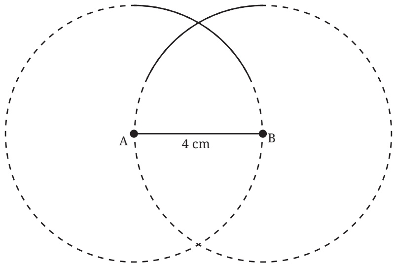
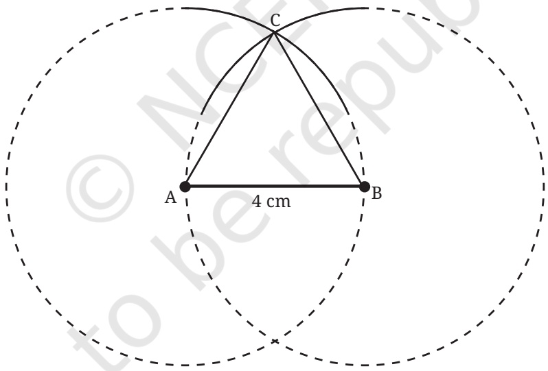

Step 2: Construct another arc of radius 4 cm from B.

Let C be the point of intersection of the arcs.

？ The construction ensures that both AC and BC are of length 4 cm. Can you see why?

**Step 3:** Join AC and BC to get the required equilateral triangle.

## 7.2 Constructing a Triangle When its Sides are Given

How do we construct triangles that are not equilateral?

? Construct a triangle of sidelength 4 cm, 5 cm and 6 cm.

As in the previous case, this triangle can also be constructed using just a marked ruler. But it will involve several trials.