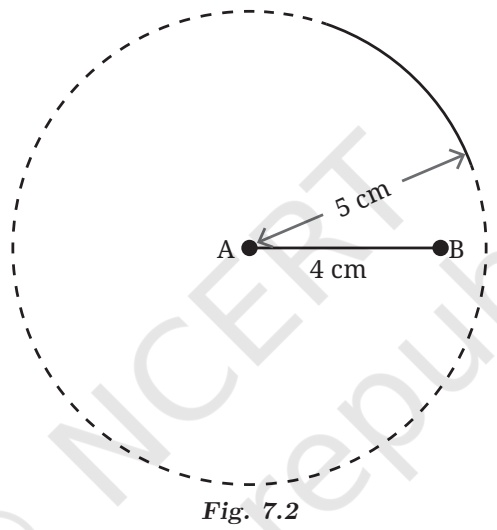
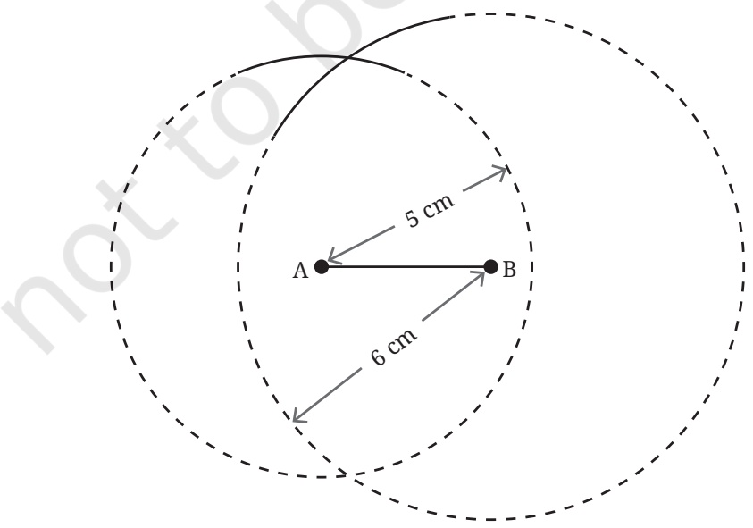

Fig. 7.1

How do we construct this triangle more efficiently?

Choose one of the given lengths to be the base of the triangle: say 4 cm. Draw the base. Let A and B be the base vertices, and call the third vertex C. Let $\mathrm { A C } = 5$ cm and BC = 6 cm.

Like we did in the case of equilateral triangles, let us first get all the points that are at a 5 cm distance from A. These points lie on the circle whose centre is A and has radius 5 cm. The point C must lie somewhere on this circle. How do we find it?

We will make use of the fact that the point C is 6 cm away from B. Construct an arc of radius 6 cm from B.

Fig. 7.3