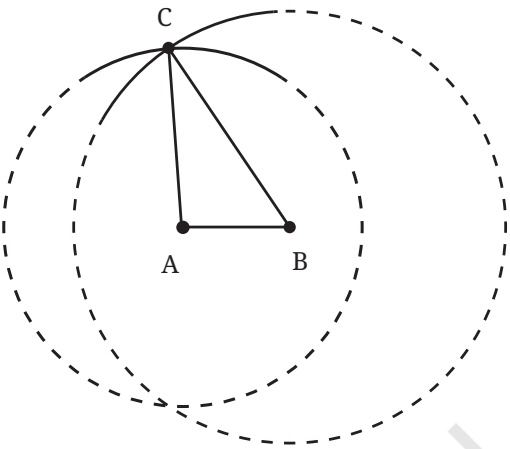
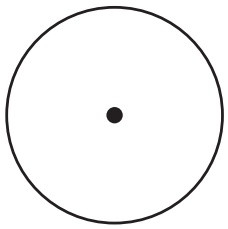

The required point C is one of the points of intersection of the two circles.

The reason why the point of intersection is the third vertex is the same as for equilateral triangles. This point lies on both the circles. Hence its distance from A is the radius of the circle centred at A (5 cm) and its distance from B is the same as the radius of the circle centred at B (6 cm).

Let us summarise the steps of construction, noting that constructing full circles is not necessary to get the third vertex (see Fig. 7.2 and 7.3).

AB = 4 cm (see Fig. 7.1).

**Step 2:** From A, construct a sufficiently long arc of radius 5 cm (see Fig. 7.2).

**Step 3:** From B, construct an arc of radius 6 cm such that it intersects the first arc (see Fig. 7.3).

**Step 4:** The point where both the arcs meet is the required third vertex C. Join AC and BC to get ∆ABC.

## Construct

？ Construct triangles having the following sidelengths (all the units are in cm):

(a) 4, 4, 6

(b) 3, 4, 5

(c) 1, 5, 5

(d) 4, 6, 8

(e) 3.5, 3.5, 3.5

We have seen that triangles having all three equal sides are called equilateral triangles. Those having two equal sides are called **isosceles triangles**.

## Figure it Out

1. Use the points on the circle and/or the centre to form isosceles triangles.

