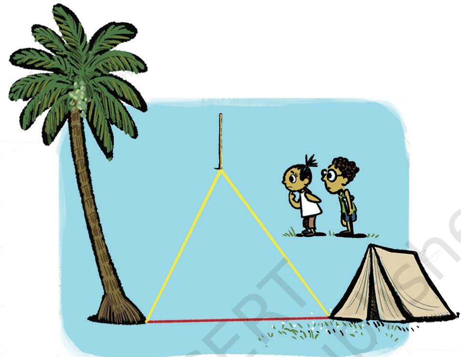
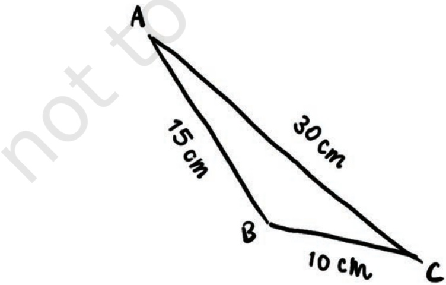

Clearly, the direct straight-line path from the tent to the tree is shorter than the roundabout path via the pole. In fact, the direct straight-line path is the shortest possible path to the tree from the tent.

Will the direct path between any two points be shorter than the roundabout path via a third point? Clearly, the answer is yes.

？ Can this understanding be used to tell something about the existence of a triangle having sidelengths 10 cm, 15 cm and 30 cm?

Let us suppose that there is a triangle for this set of lengths. Remember that at this point we are not sure about the existence of the triangle but we are only supposing that it exists. Let us draw a rough diagram.

Fig. 7.4