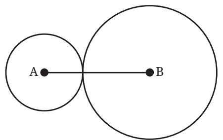
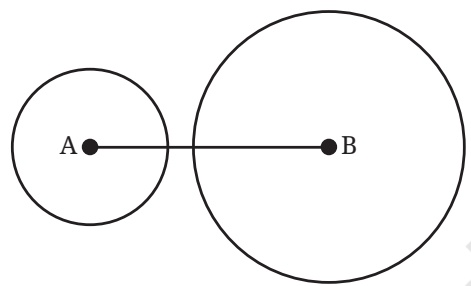
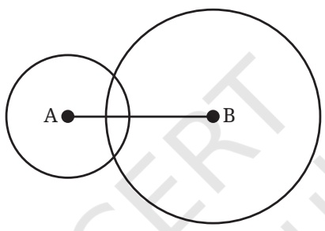

We can be sure of the existence of a triangle only if we can show that the circles intersect internally (as in Fig. 7.5) whenever the triangle inequality is satisfied. But are there other possibilities when the two circles are constructed? Let us visualise and study them.

The following different cases can be conceived:

Case 1: Circles touch each other

Case 2: Circles do not intersect

**Case 3:** Circles intersect each other internally

Note that while constructing the circles, we take

(a) the length of the base AB = longest of the given length

(b) the radii of the circles to be the smaller two lengths.

Which of the above-mentioned cases will lead to the formation of a triangle? Clearly, triangles are formed only when the circles intersect each other internally (Case 3).

Let us study each of these cases by finding the relation between the radii (the smaller two lengths) and AB (longest length).

**Case 1: Circles touch each other at a point**

For this case to happen,

$$
sum of the two radii  =  AB
$$