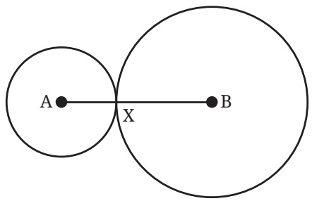
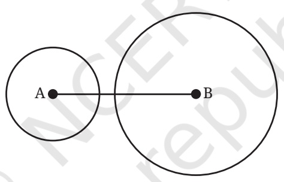
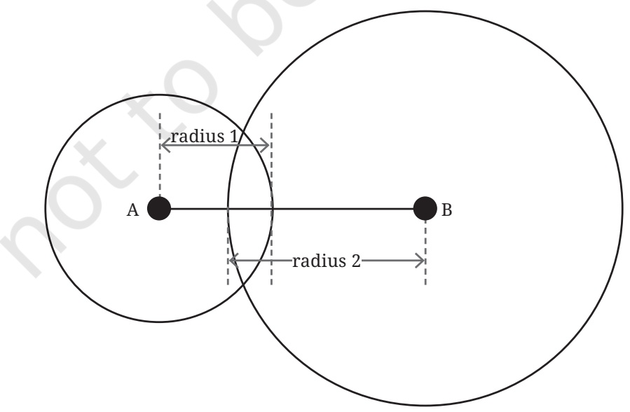

Case 2: Circles do not intersect internally

？ For this case to happen, what should be the relation between the radii and AB?

It can be seen from the figure that,

sum of the two radii < AB

sum of the the two smaller lengths < longest length

Case 3: Circles intersect each other

